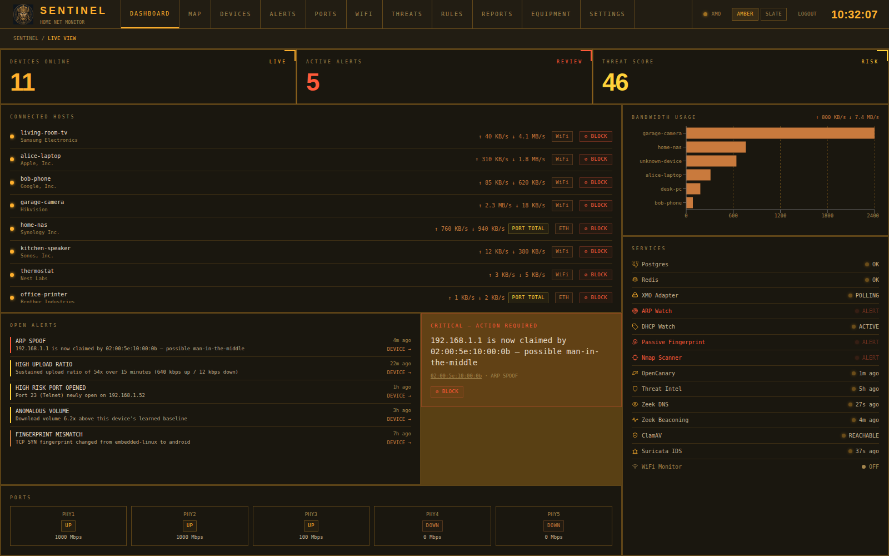
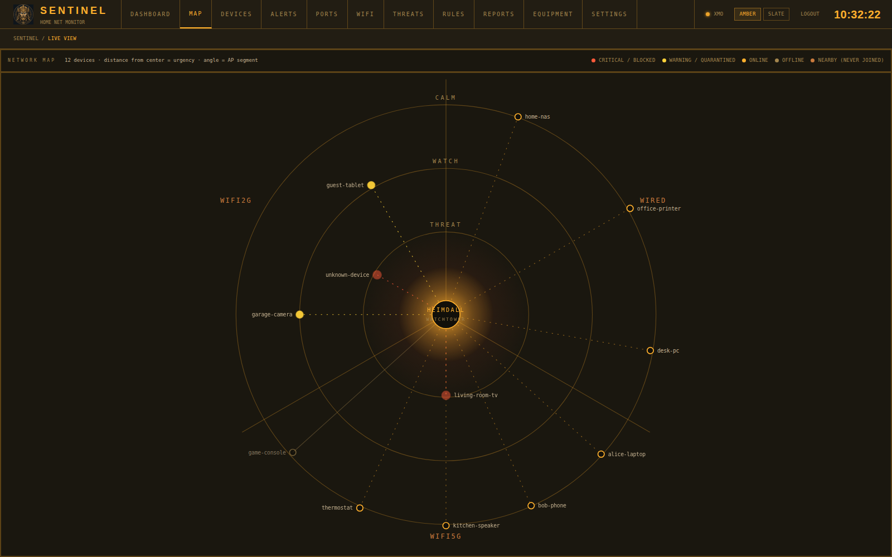
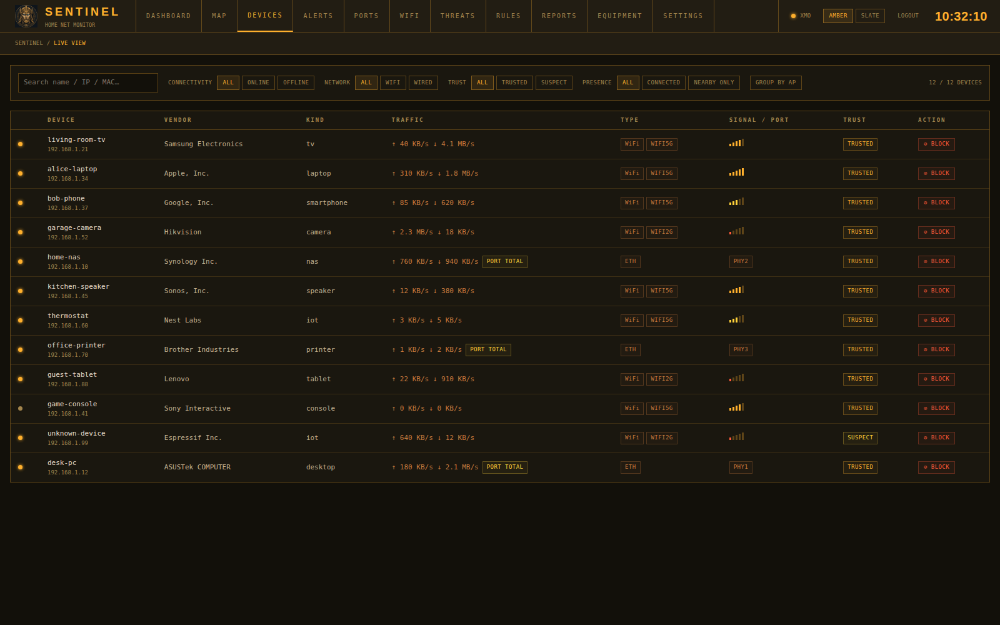
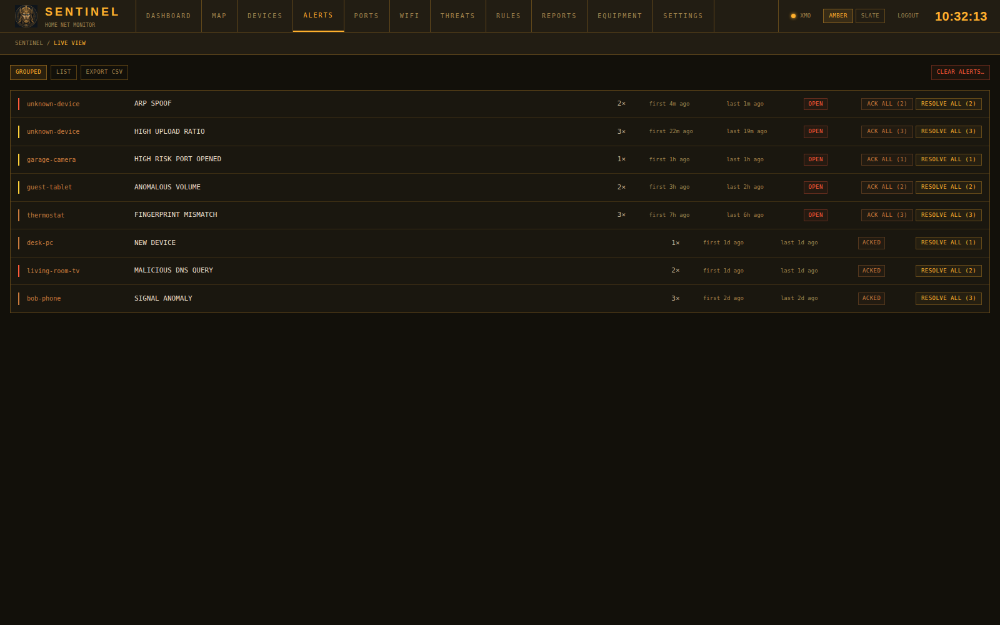
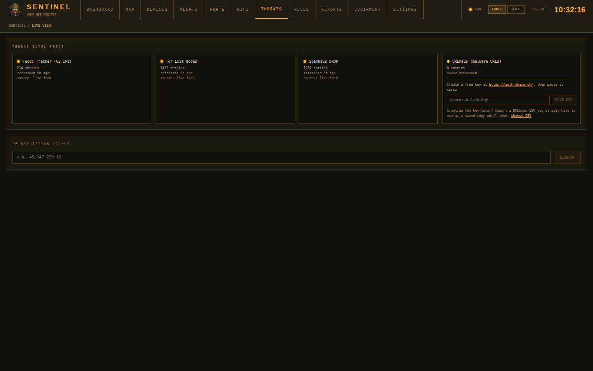
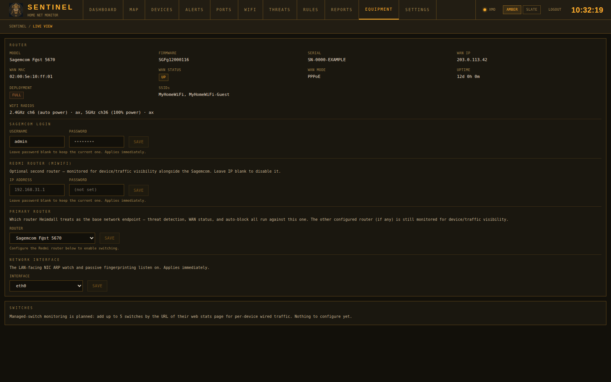

<p align="center">
  
</p>

<p align="center">
  <a href="LICENSE"></a>
  
  
  
  
  
  
</p>

<p align="center">
  
  
  
  
  
  
  
  
  
  
</p>

<p align="center">
  <a href="https://www.heimdall.it.com"></a>
  
  
  
  
  
  
  
</p>

# Heimdall 🛡️

<p align="center"><strong>A home SOC and NOC in one box.</strong><br>
<em>Security operations and network operations for your LAN — self-hosted, containerised, and watching every device.</em></p>

<p align="center">🌐 <strong><a href="https://www.heimdall.it.com">www.heimdall.it.com</a></strong> — install, user manual, security capabilities and supported equipment</p>

**Heimdall** brings the workflow of a Security Operations Center (SOC) and a Network Operations Center (NOC) to your home network. Built on a Sagemcom router API and a stack of open-source sensors, it gives you one live dashboard for both halves of the job:

- **SOC — detect and respond.** Real-time detectors, per-device ML anomaly detection, Suricata IDS, Zeek traffic inspection, an OpenCanary honeypot and threat-intel feeds raise alerts you can act on — block, quarantine, or just get notified.
- **NOC — see and understand.** A full device inventory, WiFi access-point and radio visibility, and per-device traffic show what is connected, where, and how it behaves.

Alerts and a daily security digest reach you through the dashboard, ntfy push, a Telegram channel or email.

> **Status: alpha.** Built and tested on one home network with the routers listed under [Supported routers](#supported-routers). It monitors and can block devices on your LAN — read [Known, documented limits](#known-documented-limits) and [`SECURITY.md`](SECURITY.md) before relying on it. No router? Try it with the built-in [mock router](MOCK-ROUTER-SETUP.md). Contributions welcome — see [`CONTRIBUTING.md`](CONTRIBUTING.md).

<p align="center">
  
</p>
<p align="center"><sub>The live dashboard (demo data).</sub></p>

---

## Screenshots

All screenshots use synthetic demo data — no real devices, addresses or network names.

| | |
|---|---|
| <br>**Network map** — devices by urgency (distance from centre) and AP segment (angle) | <br>**Devices** — inventory with traffic, signal, trust and block controls |
| <br>**Alerts** — grouped by device and type, with ack / resolve | <br>**Threats** — feed status, URLhaus key setup, IP reputation lookup |
| <br>**Equipment** — router details, credentials, primary-router and sniffing-interface settings | |

---

## Defenses & Capabilities

### Real-time passive detection

Runs continuously via packet sniffing (Scapy) and the router's own polled state — no active probing, so nothing here alerts the device being watched.

| Detector | What it catches |
|---|---|
| **ARP Watch** | A known IP suddenly presenting a different MAC — the signature of ARP spoofing / MITM |
| **Rogue DHCP Watch** | A DHCP OFFER from a source that isn't the known router — a rogue/malicious DHCP server on the LAN |
| **Passive OS Fingerprinting** | Guesses each device's OS from raw TCP SYN characteristics (no active scan) and flags when a known device's fingerprint suddenly changes |
| **Traffic Anomaly (ML)** | Per-device `IsolationForest` + `LOF` models, trained on that device's own history, flag statistically outlier traffic volume |
| **High Upload-Ratio Detection** | Flags a sustained high upload/download ratio — a possible exfiltration signature — with device-type-aware thresholds (a NAS/camera is expected to sustain a higher ratio than a phone) |
| **Signal-Strength Anomaly** | A WiFi device's RSSI shifting and holding at a new level — a possible sign of a MAC-cloned device swap |
| **Hostname/Vendor Mismatch** | A hostname implying a different hardware vendor than the device's actual MAC OUI |
| **AP Trust-Boundary Crossing** | A device moving between the guest and private WiFi networks — CRITICAL if it gains private access it didn't have before |
| **WiFi Monitor (Rogue AP)** | With a second, monitor-mode WiFi adapter: a non-yours access point broadcasting one of your protected network names — the signature of an "evil twin" attack. Also lists nearby WiFi devices and networks on the WIFI tab. Off until the adapter is chosen on the Equipment page |

### Active investigation

| Feature | What it does |
|---|---|
| **Nightly Nmap Scan** | Active OS detection, service enumeration, newly-opened high-risk ports (Telnet/SMB/RDP/VNC/Metasploit-default-handler and more), `--script vuln` CVE findings, and default/blank-credential NSE scripts (`default-accounts`, `ftp-anon`, `mongodb-info`, `mysql-empty-password`, …) against every known device |
| **Active/Passive OS Cross-Check** | Flags when the nightly active scan's OS detection disagrees with the passively-fingerprinted OS on file — a possible spoofing/misclassification signal |

### Deep traffic inspection (Zeek)

| Feature | What it does |
|---|---|
| **DNS Visibility** | Logs every cleartext DNS query on the wire and raises a critical alert when one resolves a domain on the URLhaus malicious-domain feed |
| **C2 Beaconing Detection** | Flags a device making suspiciously regular-interval connections to the same remote host — a classic command-and-control beacon signature invisible to any single-connection check |
| **File-Extraction → ClamAV** | Extracts files from observed cleartext downloads and scans them with ClamAV, alerting on any signature match |

### Network IDS (Suricata)

A signature-based IDS, running as a sidecar and tailed into Heimdall's own alert feed — a different detection style from the mostly-behavioral detectors above, matching live traffic against a maintained rule set (Emerging Threats) for known-bad patterns: exploit signatures, malware C2 traffic, protocol anomalies, scan patterns. Raises an `IDS_SIGNATURE_MATCH` alert per match, severity mapped from the triggering rule's own priority. **Runs with whatever ruleset the container pulls on first boot** — this integration ingests alerts, it doesn't manage or tune the ruleset itself, so a stock Emerging Threats Open set (tuned for enterprise/ISP traffic) may need suppression tuning to stop being noisy on ordinary home traffic.

### Threat intelligence

Nightly-refreshed IP/domain reputation feeds — **Feodo Tracker** (botnet C2 IPs), **Tor exit nodes**, **Spamhaus DROP** (hijacked/spam netblocks), and **URLhaus** (malware-hosting domains; needs a free [abuse.ch](https://auth.abuse.ch/) key you paste into the Threats tab — or import a URLhaus CSV until then) — plus on-demand IP lookups via **AlienVault OTX**.

### Honeypot

**OpenCanary** exposes fake vulnerable services (FTP, Telnet, SSH, HTTP, …) on the network — any interaction at all is inherently suspicious, so every trap trip is a critical alert naming the attacker's source IP.

### Response tiers

| Tier | Effect |
|---|---|
| **Block** | Removes a device from the network entirely, via the router's own device-management mechanism — effective against both WAN and purely-local LAN traffic (e.g. ARP spoofing) |
| **Quarantine** | A softer tier: cuts WAN/internet access via a router firewall rule while leaving the device reachable on the LAN — for a suspect-but-unconfirmed device you don't want to fully cut off yet |
| **Time-limited auto-block** | An automatic block (never a manual one) expires after a configurable window and sends a review notification, instead of staying blocked forever on a possible false positive |
| **Cross-alert correlation** | Recognizes specific alert *pairs* on the same device in a short window (e.g. a brand-new device immediately spoofing, or a known exposure followed by real compromise signs) and escalates them into one higher-severity incident instead of leaving them as two isolated rows |

Blocking and quarantining a device are manual actions. Automatic blocking (`auto_block_on_threat`) is **on by default** for a new install and can be turned off from the Settings page; an automatic block expires after 24 hours by default.

### Visibility

- Full device inventory — MAC, IP, hostname, vendor, device type, signal strength/rate, traffic, which WiFi access point it's on (with a "GROUP BY AP" view)
- Household WAN bandwidth tracking with spike detection
- WiFi radio channel/power/standard visibility per band
- Physical wired port topology (PHY1–PHY5), including the router's per-port byte counters
- Live dashboard over WebSocket (Flask-SocketIO) — device joins/leaves, alerts, and traffic updates push instantly, no polling

### Notifications & reporting

- Push (ntfy.sh), Telegram channel and email (SMTP) notifications, configurable from the Settings page (the Telegram bot token is kept in a secret file)
- Daily security digest — a summary of alert counts by severity/type since the last digest, including a calm "all clear" message on a quiet day
- CSV alert export for audit trails / incident record-keeping
- Prometheus-style `/api/metrics` endpoint (device counts, alert rates, poll latency) for pointing an existing Grafana/Prometheus home-lab setup at Heimdall

### Known, documented limits

Being upfront about what Heimdall does **not** do, rather than leaving it to be discovered:

- **Rogue AP / "evil twin" detection** needs extra hardware: it runs only when you add a second, monitor-mode WiFi adapter and choose it on the Equipment page, listens on 2.4 GHz channels 1, 6 and 11 only, and cannot block anything. It is off by default.
- **On an ordinary switch, Heimdall does not see other devices' private traffic** — the sniff interface hears broadcast, multicast and its own machine's traffic. Suricata and Zeek see more only if the switch or router mirrors traffic to Heimdall's port.
- **Active port-scan detection** (someone scanning *you*) has no dedicated signature — Heimdall's own nightly scan runs *outward* against devices it already knows, it doesn't detect incoming scans.
- **DNS-over-HTTPS/TLS** traffic bypasses DNS visibility (only cleartext UDP/53 is inspected), and **TLS-encrypted downloads** bypass the ClamAV file-extraction pipeline (no TLS interception is configured).
- **Suricata's ruleset is unmanaged by Heimdall** — this integration ingests whatever alerts the container produces, it doesn't fetch, verify, or tune the rule set itself (see the Network IDS section above).

See [`docs/testing/heimdall_verification.md`](docs/testing/heimdall_verification.md) for a full Kali-Linux-based penetration test plan covering every capability above (and every documented gap).

---

## Stack

| Layer | Technology |
|---|---|
| Backend | Python 3.12 · Flask 3 · Flask-SocketIO · APScheduler |
| ML | scikit-learn (`IsolationForest`) · PyOD (`LOF`) |
| Database | PostgreSQL 16 + TimescaleDB |
| Cache / event bus | Redis 7 (Pub/Sub) |
| Frontend | React 19 · Vite · Tailwind CSS |
| Network analysis | Scapy · python-nmap · Zeek · ClamAV · OpenCanary · Suricata |
| Containers | Docker Compose |

## Supported routers

Pick your router family on the **Equipment** tab and add its login there (stored in a secret file, never the database).
**Tested on real hardware** means someone ran Heimdall against that physical router; it is the only column that proves an adapter works.

| Router family | Adapter | Tested on real hardware | Automated tests (as of 2026-10-25) | Simulator |
|---|---|---|---|---|
| Sagemcom F@st 5670 (XMO API) | ✅ Implemented | ✅ Yes — primary, most-tested | ✅ Unit tests | WireMock (partial) |
| Xiaomi / Redmi, stock MiWiFi firmware (e.g. RA67) | ✅ Implemented | ✅ Yes — optional second router | ✅ Unit tests | WireMock |
| OpenWrt (ubus) | ✅ Implemented (simulator-tested only) | ❌ No | ✅ Tests against the real OS in Docker | Real OpenWrt in Docker (`tests/simulators/`) |
| MikroTik RouterOS 7 (REST) | ✅ Implemented (simulator-tested only) | ❌ No | ✅ Tests against the real OS in Docker | Real RouterOS CHR in Docker (`tests/simulators/`) |
| Ubiquiti UniFi Network | ✅ Implemented (simulator-tested only) | ❌ No | ✅ Contract + behaviour tests vs WireMock | WireMock (synthetic) |
| OPNsense | ✅ Implemented (simulator-tested only) | ❌ No | ✅ Contract + behaviour tests vs WireMock | WireMock (synthetic) |
| pfSense (REST API package) | ✅ Implemented (simulator-tested only) | ❌ No | ✅ Contract + behaviour tests vs WireMock | WireMock (synthetic) |
| AVM FRITZ!Box (TR-064) | 🛠️ Planned | ❌ No | ⏳ None yet (stubs only) | WireMock (synthetic) |
| ASUS / Asuswrt-Merlin | ✅ Implemented (simulator-tested only) | ❌ No | ✅ Contract + behaviour tests vs WireMock | WireMock (synthetic) |
| TP-Link Archer / Deco | 🛠️ Planned | ❌ No | ⏳ None yet (stubs only) | WireMock (synthetic) |
| Netgear Nighthawk / Orbi | ✅ Implemented (simulator-tested only) | ❌ No | ✅ Contract + behaviour tests vs WireMock | WireMock (synthetic) |
| Keenetic (RCI) | 🛠️ Planned | ❌ No | ⏳ None yet (stubs only) | WireMock (synthetic) |
| Anything else (passive mode) | ✅ Implemented — no router login | ❌ No | ✅ Unit tests against canned ARP/nmap output; checked live on one LAN | None needed |

**Implemented (simulator-tested only)** means the adapter builds from your Equipment-tab login and passes automated tests against a simulator — hand-written WireMock stubs for UniFi, OPNsense and pfSense, and the real OpenWrt / RouterOS operating systems running in Docker for those two — but it has never touched a physical router, so expect quirks and please report them. OpenWrt, OPNsense, pfSense, Netgear and ASUS cannot block or quarantine devices, and none of the implemented non-Sagemcom/Redmi routers except UniFi report per-device traffic (their APIs have no per-client counters). MikroTik can block via a firewall rule, but whether it enforces is unverified because the simulator carries no traffic. Selecting one of these as the *primary* router for threat detection is not wired into the scheduler yet.

**Anything else (passive mode)** works with any router: no login, Heimdall finds devices from its own host's ARP table and a periodic ARP sweep. It gives you the device inventory, new-device alerts and everything that only needs the sniff interface (ARP/DHCP watch, OS fingerprinting, Nmap, Suricata, Zeek, ClamAV, honeypot, threat intel). It cannot give per-device traffic, WAN stats or block/quarantine, and it cannot confirm a DHCP reassignment, so expect an occasional false `ARP_SPOOF`. Pick it on the Equipment tab, then set it as the primary router. Details: [`docs/architecture/14-passive-adapter.md`](docs/architecture/14-passive-adapter.md).

**Planned** routers can be selected and have their login saved, but Heimdall cannot poll them until the adapter ships. The WireMock stubs are hand-written from public API docs, so they prove nothing about a real device.
**Own one of these routers? You can help — see [Help test your router](CONTRIBUTING.md#help-test-your-router).** Roadmap: [`docs/router-and-switch-expansion-plan.md`](docs/router-and-switch-expansion-plan.md); stubs: [`wiremock/`](wiremock/README.md).

---

## Installation

Requires a Linux host with Docker, on the same LAN as the router it will monitor (several containers run with `network_mode: host` to sniff ARP/DHCP/DNS traffic directly).

Installing on a dedicated home lab box at a fixed internal IP, pulling
pre-built images instead of building from source? See
[`docs/homelab-deployment.md`](docs/homelab-deployment.md) for that specific
walkthrough — the general steps below still apply, this just sequences them
for that setup.

### Quick install (pre-built images, no clone)

> Available from the first tagged release (`v0.1.0`); until then use the from-source steps below.

```bash
curl -fsSL https://heimdall.it.com/install.sh | bash -s -- --tier=intermediate   # minimal | intermediate | full
```

This downloads the release bundle, **verifies its SHA-256**, generates secrets unique to your machine, detects your LAN interface and subnet, and runs `docker compose pull && docker compose up -d` from `~/heimdall`. It does not touch your router. Prefer to read it first? The script is [`install/get-heimdall.sh`](install/get-heimdall.sh); the manual route is: download `heimdall-bundle.tar.gz` and its `.sha256` from the [latest release](https://github.com/danielonet/heimdall/releases/latest), check it with `sha256sum -c`, extract, run `./setup.sh`, then `docker compose pull && docker compose up -d`. On a fresh install it asks for the **dashboard user name and password** you will sign in with (a password of at least 12 characters; press Enter at either prompt to keep `admin` and a generated password). The password is kept only in `~/heimdall/secrets/admin_password.txt`. For an unattended install pass `--admin-user=NAME --admin-password-file=PATH` (a file, so the password never shows in the process list). Re-running the same command upgrades in place, keeps your secrets and `.env`, and does not ask again. Open `http://<this-machine>:3000`, log in with that user, then pick your router on the Equipment tab (choose **Other / not listed** if yours isn't there). Requires Docker with the compose plugin (`--install-docker` installs it for you).

#### Debian / Ubuntu: the `.deb` package

Each release also carries `heimdall_<version>_all.deb` (plus a `.sha256`). It installs the same stack under `/opt/heimdall`, a `heimdall` command and a systemd unit, and **starts nothing** until you ask:

```bash
curl -fsSLO https://github.com/danielonet/heimdall/releases/latest/download/heimdall_all.deb
sudo apt install ./heimdall_all.deb     # pulls in docker.io, the compose plugin, openssl, iproute2
sudo heimdall setup                     # tier and router; generates this machine's secrets
sudo heimdall start                     # pulls the images; starts now and at every boot
```

Other commands: `heimdall status | logs [service] | password | upgrade | stop | reset`. Upgrading the package (`sudo apt install ./newer.deb`) moves `IMAGE_TAG` in your `.env` and restarts the stack; secrets, tier and router choice are kept. Removing or purging the package stops the containers but keeps `.env`, `secrets/` and the database volume, because the database was created with those secrets; `sudo heimdall reset` deletes everything. A signed apt repository (so `apt upgrade` finds new versions by itself) is planned.

### 1. Choose an installation tier and run the installer (from source)

| Tier | Containers beyond core (Postgres/Redis/backend/frontend) | Installer |
|---|---|---|
| **minimal** | none | `sudo ./scripts/install-minimal.sh` |
| **intermediate** | + OpenCanary (honeypot) | `sudo ./scripts/install-intermediate.sh` |
| **full** | + Zeek, ClamAV, Suricata | `sudo ./scripts/install-full.sh` |

Every tier gets the full passive/active detection set above (ARP/DHCP/
fingerprint watchers, ML anomaly detection, nmap, threat intel) and the
same block/quarantine/auto-block response — none of that needs an extra
container. The tier only decides which of Zeek/ClamAV/OpenCanary/Suricata
actually run. See [`docs/deployment-tiers-plan.md`](docs/deployment-tiers-plan.md).

```bash
git clone https://github.com/danielonet/heimdall.git heimdall
cd heimdall
sudo ./scripts/install-full.sh      # or install-minimal.sh / install-intermediate.sh
```

Each is a thin wrapper around `sudo ./scripts/install.sh --tier=<minimal|intermediate|full>`,
which is idempotent (safe to re-run) and handles: system packages (Docker, nmap, libpcap, Node), Python/Node dependencies, a `secrets/` scaffold with dev placeholders, an `.env` scaffold (including `DEPLOYMENT_TIER`) with safe dev defaults, and only the config directories the chosen tier's containers actually need (`suricata/` for full, `opencanary/` for intermediate/full).

> **What the installer changes on your machine** (it needs `sudo`, so read [`scripts/install.sh`](scripts/install.sh) first): installs apt packages (Docker Engine + compose plugin, nmap, libpcap, build tools, Node.js, …), adds your user to the `docker` group, and creates `secrets/` (mode 700) and `.env` in the repo directory with randomly generated passwords. It does not touch your router or network configuration. Several containers run with host networking and `NET_RAW`/`NET_ADMIN` capabilities to sniff LAN traffic — see [`SECURITY.md`](SECURITY.md).

### 2. Fill in real secrets and configuration

```bash
# Router admin password — required, everything else has a safe default
echo "your-router-admin-password" > secrets/router_password.txt

# A real random string, not the installer's placeholder
openssl rand -hex 32 > secrets/jwt_secret.txt

# The password you'll log into the Heimdall dashboard with
echo "choose-a-strong-password" > secrets/admin_password.txt

# Optional — AlienVault OTX threat-intel lookups (free API key)
echo "your-otx-api-key" > secrets/otx_api_key.txt
```

Edit `.env` (copied from `.env.example` by the installer) — at minimum, confirm:
- `SNIFF_IFACE` — the LAN-facing interface the monitoring machine sniffs on (`ip link show` to check)
- `ROUTER_IP` — leave blank to auto-discover from the default gateway, or set explicitly
- `LAN_SUBNET` — **add this line yourself**, it isn't in `.env.example`; Zeek uses it to tell local traffic from remote (`docker-compose.yml` silently defaults to `10.100.102.0/24` if unset, which almost certainly isn't your actual subnet)

### 3. Start the stack

```bash
docker compose up -d                        # minimal
docker compose --profile intermediate up -d # intermediate
docker compose --profile full up -d         # full
```

Use whichever matches the tier you installed — `install.sh` prints the
exact command at the end of step 1.

The backend container applies the database migrations itself on every start (`python -m sentinel.db.migrate`), so there is no separate schema step. Dev mode (`run.sh`/`dev.sh`) runs `alembic upgrade head` for you.

Dashboard: `http://<host-ip>:3000` — if `secrets/admin_password.txt` is empty, the first visit asks you to create the admin account (only a hash is stored). If you put a password in that file, log in with `admin` (or the `ADMIN_USERNAME` you set in `.env`) and that password.

Notifications (ntfy/Telegram/SMTP) are configured from the Settings page after first login, not via `.env` — see the **NOTIFICATIONS** section there.

### Offline development (no real router needed)

```bash
USE_MOCK_ROUTER=true docker compose up -d
```

The dashboard runs normally against synthetic device/traffic data generated by `MockSagemcomAdapter`. See [`docs/architecture/10-mock-router.md`](docs/architecture/10-mock-router.md).

---

## Documentation

The website, **[www.heimdall.it.com](https://www.heimdall.it.com)**, has the install command, the user manual (one chapter per dashboard page), a page for every security product and the supported-equipment table. Its source is in [`website/`](website/) (Astro + Starlight, deployed by GitHub Actions); see [`website/README.md`](website/README.md).

Full architecture and design documents live in [`docs/`](docs/) — start with
[`docs/architecture/01-system-overview.md`](docs/architecture/01-system-overview.md).
A running log of what's built vs. proposed vs. deliberately out of scope is
kept in [`docs/capability-review.md`](docs/capability-review.md).

## License

MIT — see [`LICENSE`](LICENSE).
